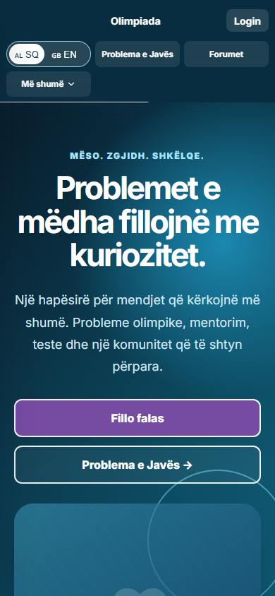
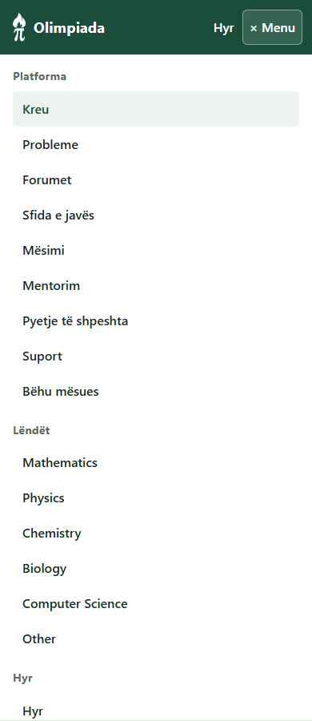
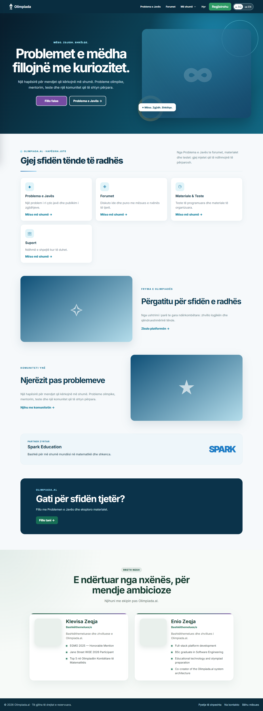
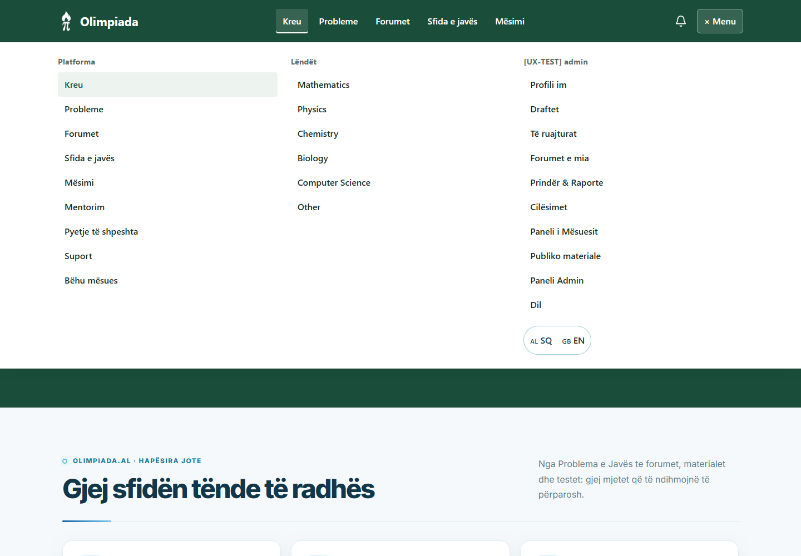

# UX unification, phases 1–2 — review report

Prepared 8 November 2026. Branch: `feat/ux-unification-phase-1-2`. Baseline and latest fetched master: `78eaff681bab7316cea5c3b0c9ea614f6c61464c`.

This is a review branch, not a production-readiness guarantee. No production records, environment variables, schema, scheduler settings, deployment, or master branch were changed. The original working copy and its pre-existing edits were left alone.

## What changed

- One shared forest-green header and navigation map across the homepage and interior sections. Learning, Weekly, Forums, Help, Tutoring, Family and permitted authoring/admin tools are discoverable. Mobile menus stay within the viewport; Escape restores focus.
- `/forums` is canonical. Signed-in visitors keep the original search, filters, creation, private forums, requests, invitations, memberships and moderation implementation. Guests get approved public forum discovery and clear login/privacy guidance. `/forum-catalog` redirects. The unused catalogue component remains in the repository for reference.
- `/admin/branding` redirects to `/admin/site-content`. Public/private profiles, FAQ editing versus site copy editing, scheduled courses versus legacy resources, and forum information versus discussion are intentionally distinct.
- Scheduled weekly publishing has one editor/reader path. Explore now reads `/core/weekly`, rather than the unrelated legacy weekly setting. Legacy learning resources have a protected `/learning-resources` reader linked from learning and their editor. No old records were deleted or transformed.
- FAQ and Support page intros consume their existing CMS blocks. Retained email templates are reachable from email administration. Duplicate admin links were removed without narrowing the existing permission union.
- Explicit recent login intents preserve the requested path, query and hash. Normal login goes to `/homepage`; old `/courses` state and intents predating logout are rejected. Late authentication responses cannot restore a logged-out token.
- Draft saves use PUT for an existing/resumed draft and remember the newly created ID for subsequent saves. Mathematical text is preserved. Selected image files remain available for publishing; the UI explicitly warns that the existing draft schema does not persist image files. No image-storage schema was invented.
- Learning separates viewing from starting a timed test. Timers use the server clock; learners see their own attempt, submission, score and feedback. Failed submissions keep text. Grading preserves the existing feedback when only the score changes.
- Thread role initialization now reacts to both user and membership data. Loading waits for the thread requests; missing messages and failed replies/deletions have visible feedback. Failed sends preserve the text.
- Recoverable loading/error states were added to touched learning, weekly, Explore, family, tutoring, authoring and discussion views. Read requests have bounded timeouts without shortening file-upload/write timeouts.
- Weekly publishing and teacher assignment now use recognizable selections; family account selection uses names/email rather than asking for raw account IDs. Existing approved-link checks remain server-enforced.
- Shared form, button, card, focus and spacing foundations use forest green, restrained purple and the existing `#1d7cc6` blue fallback from the SPARK wordmark CSS. This is not a claim to possess SPARK's official brand palette. No broad decorative redesign was performed.

## Backend reliability

1. `SessionLocal` is explicitly imported and used for owned scheduler sessions. The periodic cycle runs synchronous work in a thread instead of blocking the event loop.
2. Removed `next(get_db())` ownership mistakes. Route sessions use `Depends(get_db)`; standalone jobs close explicit sessions in `finally`.
3. Removed the global settings service that retained the first request's ORM session. Each caller now owns its settings service/session.
4. Feature middleware releases its session before invoking the route, and no longer invokes the downstream request twice when it fails.
5. The broken periodic path no longer attempts the dormant anonymization/annual-email work. Those remain in the explicit existing cron worker; fixing the NameError does not activate them. Existing unverified-user cleanup cadence is unchanged.
6. Forum presence checks only query memberships on the displayed page, with concurrency limited to four.
7. Course listings add only the current learner's attempt summary. Other learners' answers/feedback are not exposed.

Pool size was not increased. A regression test exercises 100 checks with eight workers and a two-connection pool, including exception paths, and verifies all connections return. An additional isolated PostgreSQL 17.11 run now verifies 1,105 HTTP requests up to 50 concurrent, full 15-connection pool pressure, scheduler recovery and cleanup. See [PostgreSQL results](postgres-reliability.md). This is not a production capacity benchmark.

## Verification

- Frontend: 30 tests across 12 files passed. Includes login-intent scenarios, explicit test start/server-clock handling, answer retention on failure, feedback display, grade-feedback preservation, and confirmation focus behavior.
- Backend: full suite passed (54 tests plus 68 subtests). Ownership checks cover draft read/update denial for another user; course tests verify body embargo and own-only feedback.
- Production frontend build passed. Main JS remains approximately 1.45 MB uncompressed / 391 KB gzip; Vite reports the existing large-chunk warning. Route splitting is a later performance task.
- Playwright CLI, real Chromium, local frontend `127.0.0.1:5178` against isolated backend `127.0.0.1:8018`:
  - Normal admin login → homepage → admin menu/dashboard.
  - Protected learning → login → intended destination; explicit test start and submission.
  - Catalogue redirect → original Forums.
  - New draft → repeated save → one database row → reopen → update same row, preserving mathematical text.
  - Public forum joining and forum creation with ordinary student account.
  - Publishing a learning material through the admin editor, then opening its content in the learning reader.
  - Simulated 503 → error/retry → recovered learning list, without losing account context.
  - Public routes: Forums, catalogue alias, Explore, Weekly, FAQ, Support, teacher application, missing route, verification-without-email.
  - Menu geometry, no horizontal overflow, Escape and focus return at 320, 360, 390, 768 and 1440px. Learning checked at 320/360/390/768px.
- An initial forum script failed because it requested the wrong accessible button name. It was corrected against the rendered control, rerun, and passed. The failed run also cleaned its data.

No production administrator login was used; no password was requested or retained. Local passwords are generated in memory by the loopback harness and consumed in memory by Playwright. No credentials appear in the committed screenshots or fixtures.

### Cleanup

Every browser scenario invokes verified cleanup in `finally`. The disposable backend deletes only its separately created local SQLite contents and asserts every table is empty. IDs are recorded in [cleanup-ledger.jsonl](cleanup-ledger.jsonl). Direct SQLite inspection also confirmed both browser database files and the backend suite database contain no rows. No real user data was read or removed. No external email was sent; scheduler startup and email adapters are disabled in the local harness.

### Not browser-verified / limitations

- No production write, email delivery, campaign, scheduled side effect, production file upload, or production PostgreSQL load test. Disposable local PostgreSQL verification is documented separately.
- Private invitation/retraction, parent/student consent, moderation permutations and weekly scheduling have existing/backend regression coverage, but were not all exercised end-to-end in this browser run.
- Browser creation/editing of every possible content type was not tested. Do not treat the seven journeys as exhaustive coverage of 55 routes.
- No physical iOS/Safari, Android or screen-reader session. Chromium viewport tests are not equivalent.
- Selected images are not persistent draft attachments because the existing draft contract cannot store them. Publishing support is retained; cloud upload was not exercised.
- Before-unload and in-page/link warnings cover common unsaved edits; a full router blocker for browser Back while editing remains outstanding.
- Full bilingual content conversion, all legacy modal/card accessibility, comprehensive page-by-page restyling and bundle splitting remain later work.

## Audit finding disposition

“Fixed” means the named defect was corrected in source; browser coverage is limited to the journeys listed above. “Partial” explicitly identifies retained follow-up work.

| Finding | State | Evidence / remaining work |
|---|---|---|
| F01 mobile navigation clipping | Fixed | Shared Header/CSS; five viewport checks. |
| F02 missing shared navigation | Fixed for audited standalone sections | App ConnectedPage + existing Layout; public route checks. |
| F03 legacy weekly publishing | Fixed | AdminContent points to AdminWeekly; Explore and Weekly use scheduled reader. Legacy records retained. |
| F04 unrouted legacy resources | Fixed | Protected `/learning-resources`, editor and course links. |
| F05 FAQ/support CMS disconnect | Fixed | HelpPages uses SitePageIntro and shared language preference. |
| F06 labels/destinations | Fixed in shared navigation | navigation.js owns common routes and labels. |
| F07 detours/self-links | Fixed | Explore opens learning; forum entry points use `/forums`. |
| F08 aliases/404/orphans | Fixed for route ownership | Useful 404; catalogue and branding redirects; source retained. See route inventory. |
| F09 auth semantics | Fixed for audited auth inputs | Associated labels/autocomplete; password visibility is a button. |
| F10 mouse-only cards | Partial | Native title links in Feed, Subject and Forums; legacy author/avatar controls still need systematic conversion. |
| F11 overlays/focus | Partial | Closed forum drawer unmounted; shared modal focus hook, confirmation/create drawer Escape and focus handling. Other legacy modals remain. |
| F12 language fragmentation | Partial | Header and Help share LanguageProvider; remaining English/Albanian mixed copy needs phase 3. |
| F13 resumed drafts | Fixed for duplicate-record defect | API ownership + real browser repeated/reopened saves. Image persistence limitation and full router blocking noted above. |
| F14 learning journey | Fixed for start/submit/review gaps | Explicit start, server clock, own attempt summary, feedback, retry; regression tests. |
| F15 thread race/errors | Fixed | Membership/user derivation; coordinated load, visible send/delete errors. |
| F16 admin duplicates/roles | Fixed | Duplicate links removed; actual role displayed. |
| F17 hidden tools | Fixed | Family, Tutoring and authoring reachable through shared navigation. |
| F18 unrecoverable states | Partial | Touched workflows recover; remaining legacy pages require broader state audit. |
| F19 return/view state | Partial | Forum query/tab/page/filter URL state, profile deep tabs, BackButton fallback. Course selections/answers are not URL-persisted. |
| F20 conflicting design systems | Partial by scope | New shared tokens and touched surfaces; whole-site redesign deferred. |
| F21 route orientation | Partial | Shared skip target, main focus and titles; pages without main and screen-reader validation remain. |
| F22 request/bundle performance | Partial | Bounded membership-only presence and session fixes; bundle splitting/shared fetch cache deferred. |
| F23 auth context/verification | Fixed for named cases | Recent login intent, logout invalidation, direct verification guidance. Real email flow not exercised. |
| F24 numeric IDs | Partial | Weekly problem, teacher and family account selection; remaining email recipients and some report labels still use IDs. |
| F25 authoring discovery | Improved | Workspace/publishing links respect existing author/staff roles; server permissions unchanged. Full role-by-role browser matrix outstanding. |
| F26 fabricated health | Fixed | AdminAnalytics reports unmonitored health and unavailable uptime instead of fabricated success. |
| F27 motion | Partial / later phase | Restrained shared feedback and reduced-motion confirmation; old transition-all styles remain. |
| F28 subject prefill | Fixed | Both create links carry subject; creator normalizes subject slug. Browser test verifies mathematics. |

## Screenshots

These are evidence, not a full redesign proposal. “Before” is the prior audit baseline. Authenticated before screenshots were unavailable in that audit, so no comparisons are invented.

| Before | After |
|---|---|
|  |  |
|  |  |

[Explicit test start](screenshots/course-explicit-start.png) · [Submitted state](screenshots/course-submitted.png) · [Updated draft](screenshots/draft-updated.png)

## Review, deployment and rollback

No SQL migration is required. No settings need changing to review this branch locally. Follow [local verification instructions](verification.md). PR checks install pytest and run the new regressions; they do not deploy.

Before an approved production release, verify real environment URLs/CORS, capture current backend/frontend deployment IDs, review the completed isolated PostgreSQL results, and perform a read-only production role check. Revert/redeploy the prior application commit if needed; there is no schema downgrade or data rollback in this change. Do not enable account cleanup or email jobs as part of deploying this branch. Keep the PR in draft until the remaining verification limitations are accepted or completed.

The full baseline route list and current disposition are in [route-disposition.csv](route-disposition.csv). Review guidance applied: [Web Interface Guidelines](https://raw.githubusercontent.com/vercel-labs/web-interface-guidelines/main/command.md), with the requested design and interaction skills.
